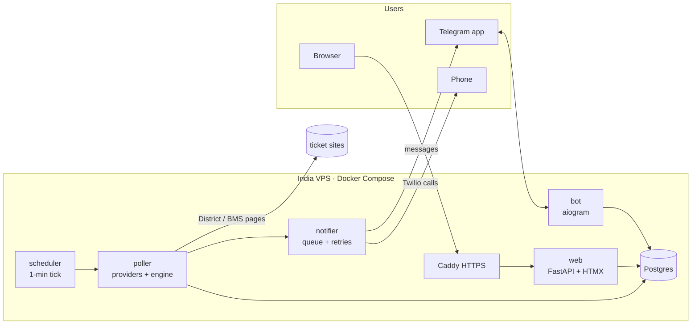

# Movie-Alert — Architecture

Status: **Phase 1 implemented on branch `v2-architecture`**; Phases 2–3 proposed.

## 1. Goals & constraints

| | Decision |
|---|---|
| Users | Friends / small group (≤ 50 people, ≤ ~200 active watches) |
| Interface | Telegram bot (setup + alerts) **and** a web dashboard |
| Alerts | Telegram messages + best-effort Telegram calls free for everyone; Twilio phone calls for users with call credits |
| Hosting | One small VPS in India (~$5–10/mo), Docker Compose |
| Latency | Detect openings / seat releases within ~60 s |

Hard constraints discovered while building v1:

- **Geo-blocking** – BookMyShow (and sometimes District) block non-India / datacenter IPs. An India VPS removes the need for ScraperAPI.
- **No official APIs** – we read the same public showtime pages any visitor sees. District embeds per-show format, language and seats in `__NEXT_DATA__`; BMS only reveals *which venues list a date*. Page layouts can change, so parsing is isolated per provider.
- **Politeness** – we must not hammer the sites. Fetches are shared across users (see §3) and capped at 1/min per page.
- **ToS** – automated *booking* is against both sites' terms; Movie-Alert only alerts. A human books.

## 2. Phase 1 (done): configurable core

```
watches.json ──▶ config.py (validate, env: refs) ──▶ runner.py
                                                       │ 1. plan distinct (provider,url) pages
                                                       │ 2. fetch each ONCE  ──▶ providers/district.py
                                                       │                      └─▶ providers/bms.py
                                                       │ 3. for each watch: engine.evaluate()  (pure)
                                                       │ 4. notify.py → Telegram msg / Twilio / CallMeBot
                                                       └ 5. watch_state.json (v2, per-watch)
```

Package layout:

| Module | Responsibility |
|---|---|
| `moviealert/models.py` | Provider-neutral `Show` and `Event` |
| `moviealert/config.py` | Load `watches.json`, resolve `env:NAME` secrets, validate with readable errors |
| `moviealert/providers/` | One module per site: `fetch_shows(url, date) -> [Show]`; `http.py` handles India egress / ScraperAPI fallback |
| `moviealert/engine.py` | **Pure** diff of shows vs. previous state → `OPENED` / `SEATS BACK` events (unit-tested) |
| `moviealert/notify.py` | Channels; account creds from env, per-user destinations from config |
| `moviealert/runner.py` | One polling round: shared fetch, fan-out, cooldowns, state persistence (auto-migrates v1 state) |
| `moviealert/__main__.py` | CLI: `run`, `check-config`, `theatres <watch>`, `test-call <user>` |

Adding a provider (e.g. Paytm/TicketNew) = one new module + one registry line. Adding a channel (WhatsApp, push) = one function in `notify.py`.

## 3. The key scaling idea: fetch once, fan out

All watches for the same **(provider, city, movie, date)** share one page fetch. 50 friends watching *Doomsday · Chennai · 17 Dec* still cost **one District request per minute**, not 50. Load on the sites grows with the number of *distinct movie-city-date pages*, not with users.

```
           watches (many)                       pages (few)             sites
 u1: Doomsday CHN 17 Dec, GK Porur ─┐
 u2: Doomsday CHN 17 Dec, any IV 3D ├──▶ district|doomsday|chennai|17 ──▶ 1 req/min
 u3: Doomsday CHN 17 Dec, IMAX      ┘
 u4: Doomsday BLR 18 Dec ──────────────▶ district|doomsday|bengaluru|18 ─▶ 1 req/min
```

## 4. Target architecture (Phases 2–3)



One Python codebase, several processes (same image): `bot`, `web`, `worker` (scheduler + poller + notifier). At this scale no Redis/Kafka is needed — Postgres doubles as the job/notification queue (`SELECT … FOR UPDATE SKIP LOCKED`).

### Components

- **bot** – `/start` links the Telegram account; `/watch` wizard: movie → city → date → theatres (picked from the live catalog, or "any Infinity Vision / IMAX / 3D") → language/format → seats → time window; `/list`, `/pause`, `/delete`, `/credits`. Alerts arrive in the same chat with inline buttons (Open District · Open BMS · Snooze 1h · Stop).
- **web** – sign in with the **Telegram Login Widget** (no passwords; same identity as the bot). Dashboard to browse theatres per city with live seat counts, manage watches, see alert history, phone number + verification, call credits. Admin page for you: users, credits top-up, provider health.
- **worker**
  - *scheduler*: every minute builds the distinct page set from active watches (`GROUP BY provider, city, movie, date`).
  - *poller*: fetches each page once (Phase 1 providers), stores a compact snapshot, runs `engine.evaluate` per watch.
  - *notifier*: delivers events with per-user cooldown + dedupe; Twilio only if the user has credits; retries with backoff; records delivery status.
  - *catalog*: hourly, refreshes movies and cinemas per city so the bot/web can offer pickers instead of regexes.

### Data model (Postgres)

```
users(id, telegram_id UNIQUE, name, phone, phone_verified, callmebot_handle,
      call_credits INT, is_admin, created_at)
watches(id, user_id → users, provider_set TEXT[], city, movie_code, movie_name, date,
        language, formats TEXT[], theatre_ids TEXT[] NULL, theatre_regex NULL,
        format_regex NULL, min_seats, show_from, show_to,
        alert_on_open, alert_on_seats, calls_enabled, active, expires_at, created_at)
pages(id, provider, city, movie_code, date, url, last_fetched_at, last_ok_at, fail_count)
show_state(page_id, cinema_id, session_id, avail, total, fmt, lang, show_time, first_seen_at, updated_at)
watch_seen(watch_id, cinema_key, first_announced_at)           -- "already announced open"
events(id, page_id, type, cinema_id, session_id, payload JSONB, created_at)
deliveries(id, event_id, user_id, channel, status, error, created_at)
credit_ledger(id, user_id, delta, reason, created_at)          -- top-ups and call charges
catalog_movies(provider, city, movie_code, name, release_date, refreshed_at)
catalog_cinemas(provider, city, cinema_id, name, chain, formats TEXT[], refreshed_at)
```

`show_state` is per *page*, not per watch — engines compare against it once and fan events out to every matching watch, so cost stays O(pages).

### Calls & credits

- Free for everyone: Telegram messages + CallMeBot Telegram call (best effort; it often skips with "FLOOD").
- Twilio calls cost ~₹4–5 each → `call_credits`. You top up friends manually after they pay you by UPI (`credit_ledger` row via admin page/bot command). Each placed call debits 1 credit; no credits → message + Telegram call only.
- **Twilio must be upgraded from trial** before calling anyone except your own verified number.
- Phone verification: Twilio Verify (one SMS/OTP) before a number can receive calls.

### Security & privacy

- Secrets only in the VPS `.env` (Docker secrets); never in the repo or logs.
- Phone numbers encrypted at rest (pgcrypto / app-level Fernet key).
- Telegram Login hash verified server-side; web sessions are signed cookies.
- Per-user limits: max active watches (e.g. 10), max calls/day.
- Watches auto-expire the day after their date.

### Reliability

- Provider failure isolated (one broken parser never blocks others); `pages.fail_count` → admin alert after N consecutive failures (layout change).
- Notifier is idempotent per `(event_id, user_id, channel)`.
- Health: `/healthz`, heartbeat message to admin if no successful poll for 5 min; Uptime Kuma or Healthchecks.io ping.
- Daily `pg_dump` to object storage.

### Capacity check

≤ 200 watches over maybe 20 distinct pages → 20 fetches/min, each ~400 KB → < 1 MB/s bursts, trivial CPU. A 1 vCPU / 1–2 GB VPS (Hetzner/DigitalOcean/Lightsail Mumbai) is plenty.

## 5. Roadmap

| Phase | Scope | Output |
|---|---|---|
| **1 – done** | Package refactor, multi-user/multi-watch config, shared fetch, pure engine + tests, `theatres` discovery CLI | branch `v2-architecture` |
| **2** | VPS + Docker Compose, Postgres schema + migrations (Alembic), worker on DB, Telegram bot wizard, credits, Caddy | friends can self-serve via Telegram |
| **3** | Web dashboard (Telegram login, watches CRUD, live theatre browser, alert history, admin) | full UI |
| 4 (optional) | More providers (TicketNew/Paytm), more cities' catalog, WhatsApp channel, PWA push | |

## 6. Decisions log

| Decision | Why | Alternative rejected |
|---|---|---|
| Python monolith, multiple processes | Reuse v1 parsers; one codebase; small team | Microservices – overkill at ≤ 50 users |
| Postgres as queue | One stateful dependency to back up | Redis/RabbitMQ – extra moving part |
| India VPS | No geo-block → no ScraperAPI cost; 1-min polling without CI limits | GitHub Actions (5-min cron floor, US IPs), serverless (cold starts, geo) |
| Telegram identity for web login | One account for bot + web; no passwords | Email/password, Google OAuth |
| Alerts only, no auto-booking | ToS + payment/OTP require a human | Headless booking bots |
